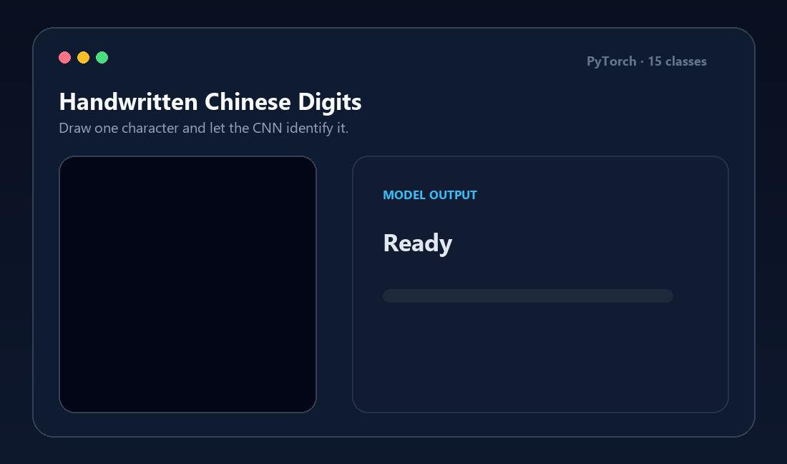
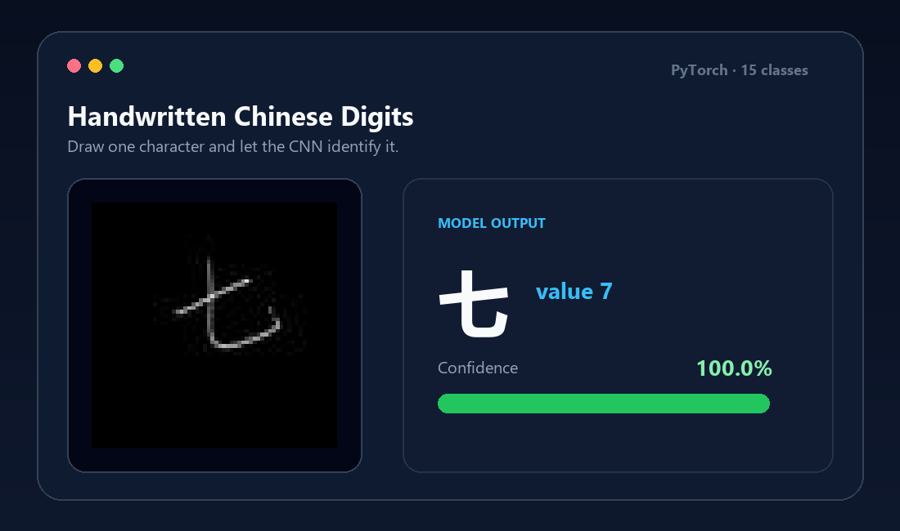
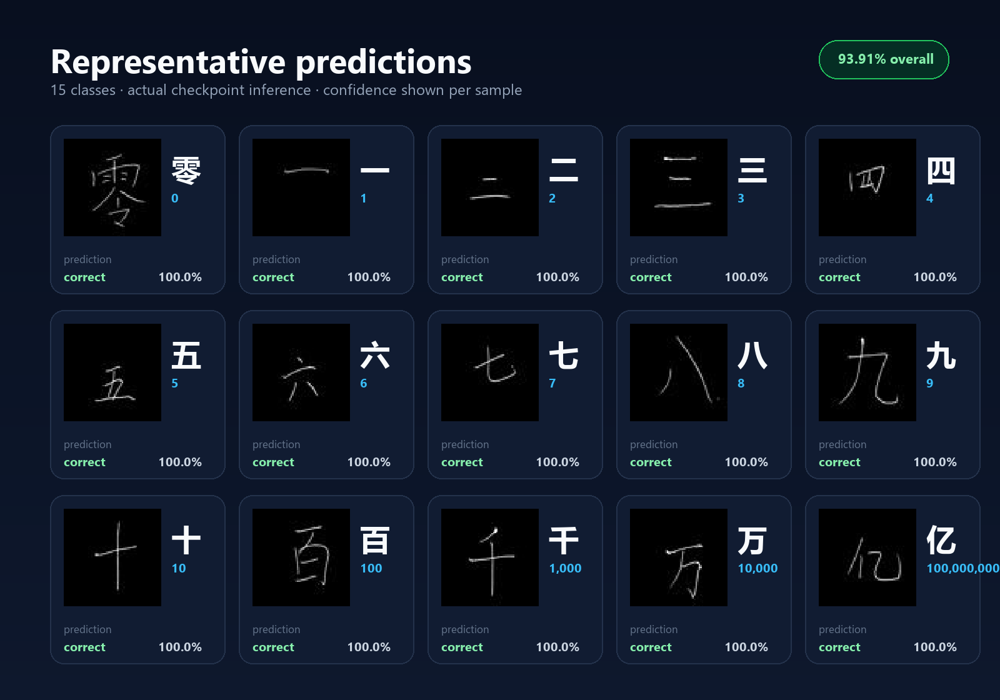
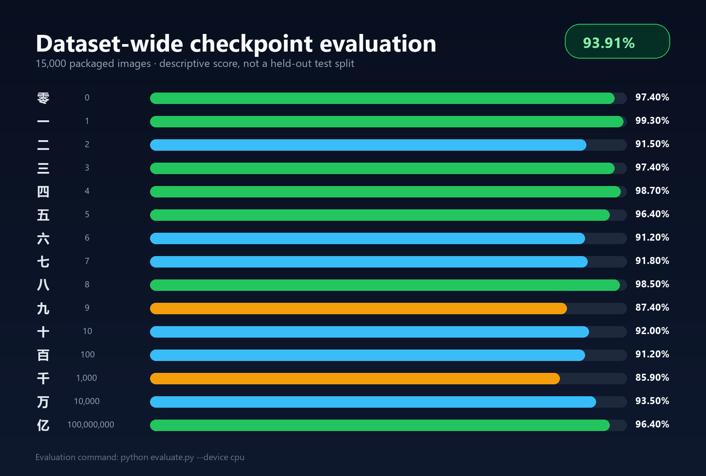

<div align="center">

# Handwritten Chinese Digits Recognition

**A compact PyTorch CNN that recognizes 15 handwritten Chinese number characters from an interactive drawing pad.**

[](https://www.python.org/)
[](https://pytorch.org/)




</div>

## Overview

This project trains and serves a convolutional neural network for recognizing handwritten Chinese digits and numerical units. It covers the characters **零, 一, 二, 三, 四, 五, 六, 七, 八, 九, 十, 百, 千, 万, 亿** and includes everything needed to explore the model locally: the Chinese MNIST archive, a pretrained checkpoint, reproducible command-line tools, and a Tkinter drawing application.

The network is intentionally small: three convolutional layers feed a 128-unit classifier for a total of **426,767 trainable parameters**. Images are converted to grayscale, resized to `28 × 28`, and normalized to `[-1, 1]` before inference.

## Core Features

- **15-class recognition** — digits zero through nine plus ten, hundred, thousand, ten thousand, and one hundred million.
- **Ready-to-use checkpoint** — run inference immediately with the included `pthmnist_cnn.pth` weights.
- **Interactive desktop demo** — draw with the mouse and view the predicted character, numerical value, and confidence.
- **No manual extraction required** — the data loader reads `MNIST7646.zip` directly.
- **Leakage-aware training** — new training runs use a deterministic 80/20 writer-disjoint split, so one writer never appears in both partitions.
- **Transparent evaluation** — the included evaluator reports aggregate and per-class performance and clearly labels the scope of the score.
- **CPU and CUDA support** — commands select CPU by default when CUDA is unavailable and accept an explicit `--device` option.

## Demo

The animation above uses a real image from the packaged dataset and the repository's pretrained checkpoint. Launch the interactive version with `python app.py`, draw one character, and select **Recognize**.

<p align="center">
  
</p>

The following grid contains one correctly classified dataset sample for every supported class. Each label and confidence value comes from actual checkpoint inference.

<p align="center">
  
</p>

## Quick Start

### 1. Clone and enter the repository

```bash
git clone https://github.com/Jiangyou-rhyyy/Handwritten-Chinese-digits-recognition.git
cd Handwritten-Chinese-digits-recognition
```

### 2. Create an environment and install dependencies

```bash
python -m venv .venv
```

Activate it on Windows:

```powershell
.\.venv\Scripts\Activate.ps1
```

Or on macOS/Linux:

```bash
source .venv/bin/activate
```

Then install the Python packages:

```bash
python -m pip install --upgrade pip
pip install -r requirements.txt
```

> For a CUDA-specific PyTorch build, use the command generated by the official [PyTorch installation selector](https://pytorch.org/get-started/locally/), then install the remaining requirements.

### 3. Prepare the dataset

No extraction is needed. The repository already contains `MNIST7646.zip`, and the loader reads its CSV index and JPEG files in place. To use another copy of Chinese MNIST, pass its archive path through `--data`.

### 4. Run the desktop demo

```bash
python app.py
```

Optional explicit paths and device:

```bash
python app.py --weights pthmnist_cnn.pth --device cpu
```

### 5. Evaluate the packaged checkpoint

```bash
python evaluate.py --data MNIST7646.zip --weights pthmnist_cnn.pth
```

### 6. Train a new checkpoint

```bash
python train.py --data MNIST7646.zip --epochs 20 --output pthmnist_cnn.pth
```

Use `--device cuda` when a compatible CUDA installation is available. Every public command also supports `--help`.

## Project Structure

```text
Handwritten-Chinese-digits-recognition/
├── app.py                       # Tkinter drawing pad and live inference
├── train.py                     # Writer-disjoint CNN training pipeline
├── evaluate.py                  # Dataset-wide checkpoint evaluation
├── chinese_digits/
│   ├── data.py                  # ZIP dataset loader and split logic
│   ├── evaluation.py            # Reusable accuracy computation
│   ├── inference.py             # Preprocessing and prediction decoding
│   └── model.py                 # CNN architecture and class metadata
├── tests/                       # Standard-library unit and CLI tests
├── assets/
│   ├── demo.gif                 # Animated real-inference demo
│   ├── app-preview.png          # Static application preview
│   ├── prediction-grid.png      # One prediction per supported class
│   └── class-accuracy.png       # Per-class checkpoint performance
├── MNIST7646.zip                # Packaged Chinese MNIST dataset
├── pthmnist_cnn.pth             # Pretrained PyTorch state dictionary
├── requirements.txt
└── README.md
```

Run the automated checks with:

```bash
python -m unittest discover -s tests -v
```

## Results

The included checkpoint correctly classifies **14,086 of 15,000 images**, giving a **93.91% dataset-wide accuracy** with the preprocessing implemented in `chinese_digits/inference.py`.

| Metric | Value |
|---|---:|
| Images evaluated | 15,000 |
| Correct predictions | 14,086 |
| Dataset-wide accuracy | **93.91%** |
| Number of classes | 15 |
| Model parameters | 426,767 |
| Checkpoint size | 1.63 MiB |

<p align="center">
  
</p>

> **Evaluation note:** the original checkpoint does not store its training indices, test indices, or random seed. The 93.91% figure is therefore a descriptive evaluation over the complete packaged dataset, **not an independent held-out test score**. New runs from `train.py` use a reproducible writer-disjoint split and print their held-out accuracy after every epoch.

## Dataset & Acknowledgements

This repository uses the [Chinese MNIST dataset published on Kaggle by G. Preda](https://www.kaggle.com/datasets/gpreda/chinese-mnist). It contains **15,000 grayscale images at 64 × 64 pixels**: 100 volunteers wrote each of the 15 characters ten times, giving 1,000 samples per class.

The data was collected as part of a Newcastle University project. Thanks to **Dr. K. Nazarpour** and **Dr. M. Chen** for collecting the original handwriting samples, and to **G. Preda** for organizing the images and publishing the CSV index used here.

Please consult the upstream dataset page for its current license and usage terms. PyTorch, Pillow, NumPy, and Python's Tkinter toolkit power the training and desktop inference workflow.
